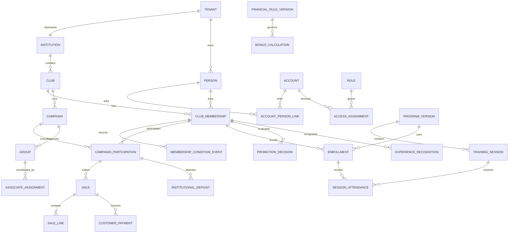

# Análisis y propuesta de etapa 1

Estado: **pendiente de validación**
Fecha: 2026-11-05

Este documento consolida los diez entregables. Distingue `DOC` (fuentes), `PROMPT` (encargo actual), `PROP` (propuesta técnica) y `PEND` (decisión pendiente). No autoriza implementación ni migraciones.

## 1 Inventario revisado

Se revisaron todos los archivos de `docs/SOURCES.md`. El SQL se trató como borrador y no se ejecutó. No existía backend implementado ni clientes Flutter/React disponibles para contrastar contratos.

## 2 Procesos, actores y requisitos

- `DOC` Inscripción diferenciada para estudiantes y no estudiantes; la Directiva revisa. No se documentan cuenta, verificación ni recuperación.
- `DOC` Campañas, participantes, grupos, asociado coordinador, campos y apelaciones.
- `DOC` GEMA aporta catálogo, precios, condición bonificable, claves, compras, créditos y boletines; no se confirma API.
- `DOC` Adquisiciones, ventas con pagos parciales y cancelación según causa/estado del material.
- `DOC` Crédito ordinario mencionado de MXN 5,000 y 10 días hábiles; confirmar vigencia antes de codificar.
- `DOC` Finanzas compara datos de GEMA y depósitos; fórmulas y excepciones siguen abiertas.
- `DOC` Capacitación/asistencia sin programas, sesiones, inscripción, resultados ni criterios de promoción.
- `PROMPT` Alta participante inicia Aspirante; promoción y experiencia previa son operaciones distintas, autorizadas y auditables.
- `PROMPT` Flutter requiere flujos de enlaces por API sin depender de React.

Actores documentados: colportor, asociado, administración, Finanzas, Directiva, departamentales, GEMA y sistemas institucionales. El encargo añade administración institucional, administración del club y plataforma SaaS.

`DOC` usa **asociado** para quien coordina grupos en campaña, gestiona solicitudes/adquisiciones y recibe comisión grupal. El manual también menciona `director asociado` como cargo temporal y `colportor asociado` como categoría financiera. `PROP`: asignación operativa por campaña/grupo con permisos limitados; no condición de membresía. `PEND` aclarar la categoría financiera.

El manual documenta Oro = principiante, Platino = experiencia media y Diamante = experto sin umbrales. La presentación Verano 2026 muestra rangos de compras/depósitos y requisitos, pero no resuelve la fórmula base.

## 3 Diferencias entre documentación y SQL

El SQL monolítico tiene 9 esquemas, 71 tablas y 41 índices explícitos. No tiene migraciones versionadas, transacción DDL, RLS ni política temporal uniforme.

| Tema | Documentación / encargo | SQL preliminar | Resolución propuesta |
|---|---|---|---|
| Tenant | Analizar institución vs club | Fija club como arrendatario | Institución como tenant; club interno |
| Institución | Reportes/Finanzas sobre clubes | Sólo texto en arrendatario | Entidad y alcance institucional |
| Persona/cuenta | Separadas de membresías | Persona vive en club | Cuenta global, persona tenant y vínculos |
| Condición | Por membresía | En Persona, default Aspirante | Mover a membresía de club |
| Experiencia | Operación distinta | No existe | Actor, motivo y evidencia |
| Capacitación | Programa/sesiones/avance | Evento + asistencia booleana | Modelo formativo completo |
| Cargos | Separados de roles | No existen | Asignaciones con vigencia |
| Tokens | Invitación/verificación/reset | Sólo verificación; códigos en texto | Hash, propósito, expiración y consumo |
| Aislamiento | App + BD | Varias FKs permiten desajuste | FKs compuestas completas |
| Inventario | Alcance abierto; GEMA fuera | No ledger real | Decidir stock propio |
| Finanzas | Histórico reproducible | Snapshot parcial | Entradas, fórmula, versión y moneda |
| Idempotencia | Reintentos móviles | Genérica/incompleta | Clave + hash + resultado |
| Migraciones | Versionadas | Script de 1,746 líneas | Migraciones numeradas |
| Hora | Política requerida | Mezcla local/UTC | UTC `datetime2(3)` |
| Comercial | No inventar reglas | Planes/prueba/gracia fijados | Dejar pendiente |

Rescatable: esquemas por capacidad, FKs compuestas, historiales específicos, snapshots, hash de token, UUID/`rowversion` e índices filtrados validados. El `.dql` no será migración.

## 4 Modelo SaaS y acceso

`PROP` El tenant de aislamiento es la **institución/universidad cliente**. Contiene uno o más clubes; la campaña pertenece a un club. La plataforma SaaS queda fuera de tenants. Si hay clubes independientes, pueden usar un tenant de tipo independiente sin alterar claves. `PEND` aprobar unidad tenant.

1. La sesión identifica cuenta; nunca se confía en tenant del cuerpo.
2. Ruta/encabezado sólo seleccionan contexto; el servidor valida asignaciones vigentes.
3. Contexto autorizado: cuenta, tenant, permisos y alcances de institución/club/grupo.
4. Consultas tenant-owned filtran contexto resuelto y parámetros.
5. Tablas tenant-owned usan unicidad `(tenant_id,id)` y FKs compuestas.
6. Acceso institucional multiclub requiere asignación institucional; Directiva no lo hereda.
7. Admin plataforma no se vuelve usuario del tenant; accesos excepcionales se auditan.
8. Tenant contempla pendiente, activo, sólo lectura, suspendido y cerrado; reglas comerciales pendientes.

RLS puede evaluarse como defensa adicional después de probar `SESSION_CONTEXT` con pool `mssql`; nunca sustituye autorización de aplicación.

## 5 Roles, condiciones, cargos y permisos

| Concepto | Ejemplos | Ámbito | Efecto |
|---|---|---|---|
| Condición | Aspirante, Colportor | Club | Experiencia del integrante; no administración |
| Estado de membresía | Pendiente, Activa, Suspendida, Finalizada | Club | Ciclo de vida independiente |
| Rol de acceso | Miembro, Asociado, Directiva, AdminClub, AdminInstitucional, Finanzas, AdminPlataforma | Asignado | Agrupa permisos |
| Cargo | Presidente, Vicepresidente, Secretario, Tesorero, Asistente, Consejero | Club/vigencia | Función organizacional |
| Alcance | Plataforma, institución, club, campaña, grupo, propio | Explícito | Limita el permiso |
| Función operativa | Asociado coordinador | Campaña/grupo | Relación de negocio y acceso limitado |

`PROP` Directiva agrupa acceso común y cargos se asignan aparte. Tesorero sólo recibe permisos financieros aprobados. Una persona puede ser Colportor y Directiva. Autorización = permiso + alcance + pertenencia + estado del tenant.

## 6 Aspirante a colportor

### Alta ordinaria

1. Invitación/enlace identifica club/campaña con token opaco, hash persistido, expiración y uso único.
2. Persona crea o vincula cuenta, verifica correo y completa datos mínimos.
3. Servidor crea Persona y Membresía en `ASPIRANT`; el cliente no puede elevar condición/rol.
4. Participación de campaña se crea aparte si aplica.
5. Aspirante se inscribe en versión de programa; avance deriva de sesiones, asistencias, resultados y criterios configurados.
6. Cumplir criterios produce elegibilidad/solicitud. `PEND` aprobación manual o automática.
7. Transición registra anterior/nueva, método `TRAINING_COMPLETION`, decisión, actor, fecha, motivo y snapshot de evidencia.

### Experiencia previa

Operación administrativa distinta con permiso específico, evidencia, motivo, actor y fecha. Registra `PRIOR_EXPERIENCE_RECOGNITION`; no falsifica asistencia ni graduación. `PROP` la condición es por club: evidencia puede reutilizarse con autorización, pero cada club reconoce expresamente.

Errores: token inválido/consumido, vínculo de identidad conflictivo, membresía duplicada, tenant suspendido, programa no vigente, criterios incompletos, alcance insuficiente o conflicto concurrente.

## 7 Modelo de datos y diagrama

- SaaS: `Tenant`, `TenantServiceState`, `Subscription` y `Plan` opcionales.
- Organización: `Institution`, `Club`, `ClubPosition`, `PositionAssignment`.
- Identidad: `Account`, `Session`, `RefreshTokenFamily`, `Person`, `AccountPersonLink`, `ActionToken`, `Invitation`.
- Acceso: `Role`, `Permission`, `RolePermission`, `AccessAssignment`.
- Membresía: `ClubMembership`, `MembershipConditionEvent`.
- Capacitación: `TrainingProgram`, `ProgramVersion`, `TrainingSession`, `Enrollment`, `SessionAttendance`, `AssessmentResult`, `PromotionDecision`, `ExperienceRecognition`.
- Operación: `Campaign`, `CampaignParticipation`, `AssociateAssignment`, `Group`, `GroupAssignment`, `Field`, `FieldAssignment`, `Appeal`.
- Material: `Material`, `CampaignCatalogItem`, `Acquisition`; ledger sólo si se aprueba.
- Ventas: `Customer`, `Sale`, `SaleLine`, `CustomerPayment`, `Cancellation`, `Refund`.
- Finanzas: `Credit`, `CreditAuthorization`, `InstitutionalDeposit`, `FinancialRuleVersion`, `BonusCalculation`, `BonusCalculationLine`, `BonusApproval`.
- Transversal: `AuditEvent`, `IdempotencyRecord`, `OutboxMessage`, `MigrationHistory`.



### Integridad y evidencia histórica

- Toda tabla tenant-owned incluye `tenant_id`; FKs compuestas también obligan coincidencia de club/campaña cuando aplica.
- Unicidad filtrada para asignaciones vigentes y tokens no consumidos, validada contra SQL Server objetivo.
- Índices por tenant + estado/fecha/campaña/membresía/grupo y FKs según consulta.
- Importes propuestos `decimal(19,4)` y moneda ISO 4217; redondeo pendiente.
- Instantes UTC `datetime2(3)`; fechas civiles `date`; API ISO 8601 `Z`.
- Transacciones para alta/invitación, promoción, reconocimiento, pagos, depósitos, reversas, venta con líneas, cálculo/aprobación y outbox.
- Idempotencia guarda tenant, actor, operación, clave, hash del request, estado y resultado. Misma clave con otro cuerpo produce conflicto.
- Dinámicos: avance actual, sumas y saldos reproducibles. Persistidos: precio/costo aplicado, crédito, regla/fórmula/entradas/resultado, moneda/redondeo, aprobaciones, sanciones y reversas.
- Fresh install y adopción de base existente son caminos separados con mapeo, respaldo y ensayo.

La presentación Verano 2026 menciona rangos 35% a 60%, GEMA 21%, ULV 14% a 39%, 80% de capacitaciones, diezmos y compatibilidad de becas. Son evidencia versionada de campaña, no reglas globales. “Compras y depósitos”, nivel medio de MXN 10,250 y compatibilidad contradicen/ambiguan otras fuentes.

## 8 Arquitectura, paquetes y módulos

```text
src/
  modules/<capability>/
    domain/
    application/
    infrastructure/
    presentation/
  shared/
    domain/
    application/
    infrastructure/database/
    presentation/http/
  composition/
migrations/
tests/
docs/
```

Interfaces de repositorio viven en aplicación porque expresan necesidades de casos de uso. DI manual. Dirección: `presentation -> application -> domain`; `infrastructure -> application/domain`; composición conoce implementaciones. Dominio/aplicación no importan Express, `mssql` u OpenAPI.

Recorrido: ruta Express -> Zod -> autenticación/contexto -> controlador -> caso de uso -> puerto de transacción -> repositorio -> adaptador `mssql` parametrizado -> resultado -> contrato HTTP -> error/log central. Aplicación define contexto transaccional abstracto; infraestructura lo implementa con `mssql.Transaction`.

| Paquete | Motivo |
|---|---|
| `express`, `mssql` | Stack obligatorio, pool y SQL Server |
| `zod` | Validación en borde HTTP |
| `@asteasolutions/zod-to-openapi`, `swagger-ui-express` | OpenAPI derivado y Swagger |
| `jose`, `argon2` | Tokens y contraseñas |
| `helmet`, `cors`, `express-rate-limit` | Protección HTTP |
| `pino`, `pino-http` | Logs con redacción |
| `dotenv` | Configuración local |
| `typescript`, `tsx`, `eslint`, `vitest`, `supertest` | Desarrollo y pruebas |

Sin ORM, contenedor DI o repositorio genérico. Migraciones SQL versionadas con runner pequeño basado en `mssql`.

Módulos: `platform`, `organizations`, `identity-access`, `memberships`, `training`, `campaigns-groups`, `catalog-inventory`, `sales`, `finance-bonuses`, `reporting-audit`, `notifications`. GEMA/sistemas institucionales son adaptadores; el núcleo admite captura/importación.

## 9 Incrementos

`docs/PLAN.md` define puerta de validación, bootstrap/aislamiento, identidad/enlaces, membresías, capacitación, campañas, catálogo, ventas, finanzas, reportes y hardening. Cada endpoint incluye validación, permisos, pruebas y OpenAPI; no se aceptan simulaciones.

Swagger: `/api/docs` y `/api/openapi.json`, configurable por entorno. Deep links usan allowlist, Universal Links iOS, App Links Android y ruta web. Backend valida token/destino y devuelve acción; Flutter completa por API sin React.

## 10 Preguntas estructurales

Las diez decisiones bloqueantes están en `docs/PROJECT_STATE.md`. Segundo nivel: si asociado exige ser Colportor, cuántos grupos coordina, visibilidad financiera del grupo, permisos por cargo, estados definitivos, datos mínimos de cliente, evidencia de experiencia, fuente autoritativa de compras/depósitos/diezmos y significado interno/externo.

No bloquean: estructura modular, DI manual, Zod/OpenAPI, Pino, migraciones SQL versionadas, pool `mssql`, errores centralizados y `/api/v1`.
